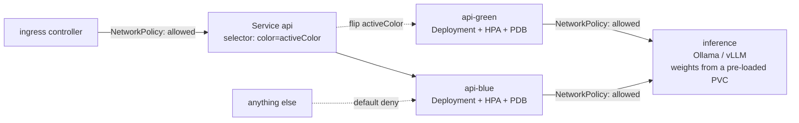

# airgapped-llm-deploy

**Deploy a RAG API and a self-hosted model server into on-prem and air-gapped Kubernetes clusters, and prove the deployment is safe before it ships.** This repo has two parts. A hardened Helm chart covers blue-green releases, autoscaling, disruption budgets, default-deny networking and non-root, read-only pods. A Python CLI handles the parts specific to disconnected sites: it lints rendered manifests against policy, bundles images and the chart with checksums for transfer, verifies the bundle on the inside, and pushes it to the internal registry.


## The problem

Plants, hospitals, banks and defense customers often can't let a cluster reach the internet. "Just `helm install`" breaks in three ways:

1. **Images can't be pulled.** Every image has to be carried in, re-hosted, and referenced by an immutable digest.
2. **Nobody can debug from outside.** The manifests have to be right the first time: resources, probes, security contexts, network policy.
3. **The transfer is a supply-chain risk.** Whatever crosses the gap has to be verifiable on the other side.

## What CI proves on every commit

| Check | Tool |
|---|---|
| Chart lints with default and air-gapped values | `helm lint` |
| Rendered chart passes policy, **standard profile** | `airgap lint` |
| Rendered chart passes policy, **air-gap profile**: every image from `registry.plant.internal:5000`, pinned by digest, never `imagePullPolicy: Always` | `airgap lint --profile airgap` |
| Every manifest is valid against the Kubernetes schemas | `kubeconform -strict` |
| Bundles detect tampered, missing and extra files | `pytest` |

The policy linter on a typical "quick demo" manifest ([fixture](tests/fixtures/bad.yaml)):

```
ERROR   host-path              Deployment/quick-demo      hostPath volume 'docker-sock' is not allowed
ERROR   mutable-tag            Deployment/quick-demo:app  image 'someorg/llm-app:latest' has no tag or uses latest
ERROR   registry               Deployment/quick-demo:app  image 'someorg/llm-app:latest' is not from registry.plant.internal:5000
ERROR   pull-policy            Deployment/quick-demo:app  imagePullPolicy Always can't work offline
ERROR   privileged             Deployment/quick-demo:app  privileged containers are not allowed
ERROR   network-policy         release                    no NetworkPolicy: pods can talk to anything
ERROR   inline-secret          Secret/api-keys            secret values must not be in manifests
...
12 error(s), 4 warning(s)
```

## The chart (`charts/llm-stack`)



| Concern | Implementation |
|---|---|
| Blue-green | One Deployment per color, and the Service selects `activeColor`. Cutover and rollback are a selector change ([runbook](docs/runbooks/blue-green.md)) |
| Autoscaling | HPA on CPU per color; PodDisruptionBudget so node drains never take the API to zero |
| Network | Default deny for the release; only ingress → API and API → inference are allowed; DNS egress only |
| Pod hardening | Non-root UID, seccomp `RuntimeDefault`, `readOnlyRootFilesystem`, all capabilities dropped, no privilege escalation, no service-account token mounted |
| Images | `global.imageRegistry` rewrites every image; `digest` pins it immutably |
| Secrets | The chart never templates secret values; it references `existingSecret` (Sealed Secrets, External Secrets or Vault) |
| Model weights | Mounted read-only from a pre-loaded volume, never downloaded at startup |

## The CLI (`airgap`)

```bash
pip install -e .
helm template demo charts/llm-stack > public.yaml
airgap lint public.yaml                              # policy check
airgap bundle public.yaml --out bundle/              # docker save every image + chart + SHA-256 manifest
# ... carry bundle/ across the air gap ...
airgap verify bundle/                                # checksums, missing files, unexpected files
airgap push bundle/ --registry registry.plant.internal:5000
```

The full step-by-step procedure is in the [air-gap install runbook](docs/runbooks/airgap-install.md).

## Design decisions

- **Policy runs on rendered output, not on templates.** What matters is what reaches the cluster after values and overrides. The same linter can check any vendor's chart a customer hands you.
- **Digests in air-gapped mode, tags elsewhere.** Tags are fine in dev. Inside a disconnected site a mutable tag means you can't prove what's running, so the air-gap profile makes digest pinning an error.
- **`verify` refuses extra files too.** A bundle that gained a file in transit is as suspicious as one that lost a file.
- **Blue-green instead of rolling updates for model changes.** A new model or prompt should be evaluated on real infrastructure before users see it, and rolled back without waiting for pods to start.

## Limitations and next steps

- Sign bundles and images (cosign) and verify signatures inside the gap, not just checksums.
- Generate an SBOM per image (syft) and include it in the bundle.
- Add GPU scheduling values (node selectors, tolerations, `nvidia.com/gpu` limits) for vLLM, and a kind-based install test in CI.

## Layout

```
charts/llm-stack/   Chart.yaml · values.yaml · values-airgap.yaml · templates/ (api, inference, networkpolicy, serviceaccount)
src/airgap/         manifests · lint · bundle · cli
docs/runbooks/      air-gap install, blue-green release and rollback
tests/              policy rules, bundle tamper detection, retagging
```
